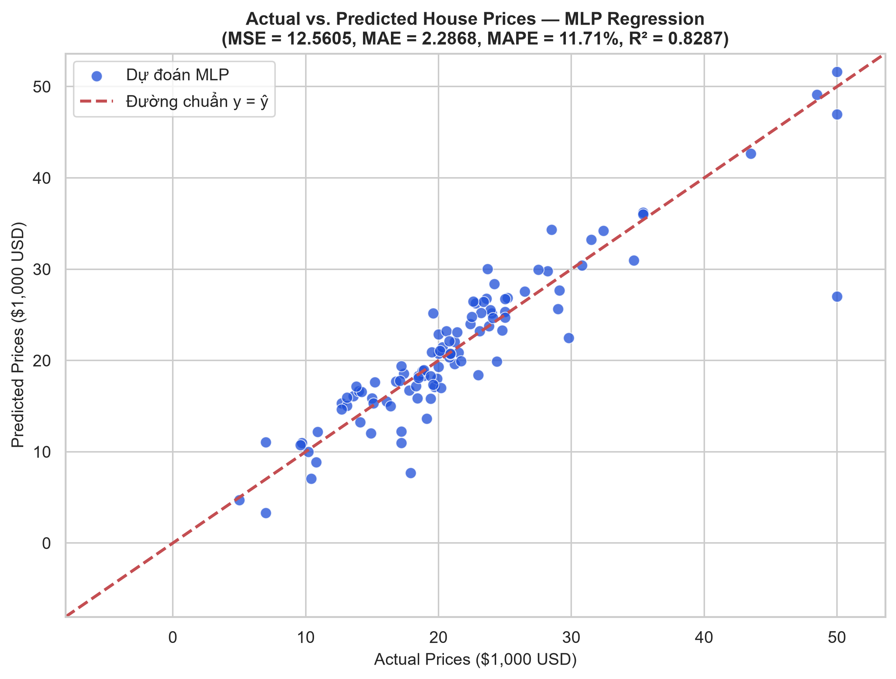

# Multilayer Perceptron Regression (`MLP Regression`)

## 1. Purpose — Mục đích

**Multilayer Perceptron Regression (`MLP Regression`)** là mô hình mạng nơ-ron nhân tạo truyền thẳng đa tầng (*Feedforward Artificial Neural Network*) đóng vai trò là thuật toán trọng tâm của **Bài thực hành Lab 04 (Chương 5: Artificial Neural Networks)**.

Mục đích của mô hình là khắc phục hạn chế tuyến tính của một Perceptron đơn tầng bằng cách xếp chồng hai tầng ẩn kết nối đầy đủ (*Fully Connected / Dense Layers*) sử dụng hàm kích hoạt phi tuyến **ReLU** kết hợp với tầng đầu ra **Linear**, giúp mô hình tự động học được các tương tác phi tuyến bậc cao giữa 13 đặc trưng đô thị (`LSTAT`, `RM`, `DIS`, `NOX`, `TAX`,...) để dự đoán chính xác giá nhà trung vị `MEDV` (`$1,000 USD`).

## 2. Input — Output

### Input

| Input | Description |
|---|---|
| `X_train_sub` `(323, 13)`, `y_train_sub` `(323,)` | Dữ liệu đặc trưng đã chuẩn hóa Z-Score và nhãn giá nhà dùng để cập nhật trọng số qua Backpropagation |
| `X_val_scaled` `(81, 13)`, `y_val` `(81,)` | Tập kiểm định độc lập dùng để theo dõi `val_loss`, `val_mae`, `val_mape` và kích hoạt `EarlyStopping` |
| `X_test_scaled` `(102, 13)` | Dữ liệu kiểm tra độc lập dùng để đánh giá hiệu năng tổng quát hóa cuối cùng |
| `config.yaml -> mlp_model` | Cấu hình kiến trúc `13 -> 32 -> 16 -> 1`, `optimizer = adam (lr = 0.005)`, `batch_size = 32`, `epochs = 100`, `patience = 15` |

### Output

| Output | Description |
|---|---|
| `Predicted MEDV` ($\hat{\mathbf{y}} \in \mathbb{R}^{N \times 1}$) | Vector giá trị nhà dự đoán liên tục (đơn vị: `$1,000 USD`) |
| `models/mlp_regression.keras` | Tệp mô hình Keras lưu trữ toàn bộ kiến trúc và **`993` tham số** tối ưu tại `Best Epoch = 70` |
| `models/mlp_training_history.csv` | Bảng lịch sử hội tụ `loss`, `mae`, `mape`, `val_loss`, `val_mae`, `val_mape` qua `85` epochs |

### Cấu trúc Tham số Mô hình (`Model Parameters` — Khớp 100% với Cell 9 `lab04.ipynb`)

| Tầng mạng (Layer) | Kích thước Trọng số `W` | Kích thước Độ lệch `b` | Hàm Kích hoạt | Số lượng Tham số |
|---|---|---|---|---:|
| **Hidden Layer 1 (`Dense 32`)** | `(13, 32)` (`416` weights) | `(32,)` (`32` biases) | `ReLU` — $\max(0, z)$ | **`448`** |
| **Hidden Layer 2 (`Dense 16`)** | `(32, 16)` (`512` weights) | `(16,)` (`16` biases) | `ReLU` — $\max(0, z)$ | **`528`** |
| **Output Layer (`Dense 1`)** | `(16, 1)` (`16` weights) | `(1,)` (`1` bias) | `Linear` — $f(z) = z$ | **`17`** |
| **Tổng cộng (`Total Trainable Parameters`)** | — | — | — | **`993`** |

## 3. How to do — Quy trình thực hiện & Cơ sở toán học

### MLP Regression workflow

```text
          Input Vector X_scaled (N x 13)
                        |
                        v
        Hidden Layer 1: z^(1) = X W^(1) + b^(1)
             a^(1) = ReLU(z^(1))  [N x 32]
                        |
                        v
        Hidden Layer 2: z^(2) = a^(1) W^(2) + b^(2)
             a^(2) = ReLU(z^(2))  [N x 16]
                        |
                        v
        Output Layer  : y_hat = a^(2) W^(3) + b^(3)
             Linear Activation    [N x 1]
                        |
                        v
        Compute MSE Loss: L = (1/N) sum(y - y_hat)^2
                        |
                        v
        Backpropagation (Chain Rule Gradients)
         dL/dW^(3) -> dL/dW^(2) -> dL/dW^(1)
                        |
                        v
        Adam Optimizer Update (lr = 0.005, batch = 32)
                        |
                        v
        EarlyStopping Check on X_val_scaled (81 samples)
         (Stop at Epoch 85 -> Restore Best Epoch 70)
```

### Các bước thực hiện

**Step 1 — Lan truyền thuận (Forward Propagation)**

Dữ liệu đầu vào đã chuẩn hóa $\mathbf{X} \in \mathbb{R}^{N \times 13}$ đi qua hai tầng ẩn `ReLU` và tầng đầu ra `Linear`:

$$\mathbf{z}^{(1)} = \mathbf{X}\mathbf{W}^{(1)} + \mathbf{b}^{(1)}, \qquad \mathbf{a}^{(1)} = \max\left(0, \mathbf{z}^{(1)}\right) \in \mathbb{R}^{N \times 32}$$
$$\mathbf{z}^{(2)} = \mathbf{a}^{(1)}\mathbf{W}^{(2)} + \mathbf{b}^{(2)}, \qquad \mathbf{a}^{(2)} = \max\left(0, \mathbf{z}^{(2)}\right) \in \mathbb{R}^{N \times 16}$$
$$\hat{\mathbf{y}} = \mathbf{z}^{(3)} = \mathbf{a}^{(2)}\mathbf{W}^{(3)} + \mathbf{b}^{(3)} \in \mathbb{R}^{N \times 1}$$

- **Vì sao dùng `ReLU` ở tầng ẩn?** Với mọi $z > 0$, đạo hàm $\text{ReLU}'(z) = 1$, giúp tín hiệu đạo hàm truyền ngược qua nhiều tầng mà không bị triệt tiêu (*Vanishing Gradient*) như hàm `Sigmoid` hay `Tanh` (minh họa tại Cell 3 `lab04.ipynb`).
- **Vì sao dùng `Linear` ở tầng đầu ra?** Giá nhà `MEDV` $\in [5.0, 50.0]$ là số thực dương liên tục nên tầng cuối không được ép vào khoảng $(0, 1)$ hay $(-1, 1)$.

**Step 2 — Tính hàm mất mát (MSE Loss Calculation)**

Đo độ sai lệch giữa dự đoán $\hat{y}_i$ và nhãn thực tế $y_i$ trên mini-batch ($B = 32$):

$$\mathcal{L}_{\text{MSE}}(\theta) = \frac{1}{B}\sum_{i=1}^{B}(y_i - \hat{y}_i)^2$$

**Step 3 — Lan truyền ngược (Backpropagation) & Cập nhật Adam**

Tính sai số tại tầng đầu ra và truyền ngược về hai tầng ẩn theo quy tắc dây chuyền (*Chain Rule*):

$$\delta^{(3)} = \frac{2}{B}(\hat{\mathbf{y}} - \mathbf{y}), \qquad \delta^{(2)} = \left(\delta^{(3)}(\mathbf{W}^{(3)})^T\right) \odot \mathbb{I}(\mathbf{z}^{(2)} > 0), \qquad \delta^{(1)} = \left(\delta^{(2)}(\mathbf{W}^{(2)})^T\right) \odot \mathbb{I}(\mathbf{z}^{(1)} > 0)$$

Bộ tối ưu **Adam** ($\eta = 0.005, \beta_1 = 0.9, \beta_2 = 0.999$) kết hợp Momentum bậc 1 và RMSProp bậc 2 để cập nhật từng cặp $(\mathbf{W}^{(l)}, \mathbf{b}^{(l)})$.

**Step 4 — Giám sát Kiểm định & Dừng sớm (`EarlyStopping`)**

Cuối mỗi epoch, mô hình đánh giá `val_loss` trên `81` mẫu `Validation`. Tại **Epoch `70`**, `val_loss` đạt mức thấp nhất **`14.0107`** (`val_mae = 2.7173`, `val_mape = 13.71%`). Sau 15 epochs tiếp theo không giảm thêm, quá trình huấn luyện dừng tại **Epoch `85/100`** và tự động khôi phục bộ trọng số của **Epoch `70`**.

## 4. Evaluation Metrics — Các chỉ số đánh giá thực nghiệm

Kết quả đánh giá chính thức của `MLP Regression` từ **Cells 11, 12, 16, 17, 19 và 20 của `lab04.ipynb`**:

| Nhóm Chỉ số | Metric | Giá trị Đạt được | Nhận xét & Ý nghĩa Học thuật |
|---|---|---:|---|
| **Hội tụ Huấn luyện (`Train_sub` 323 mẫu)** | `Epoch 1 -> Epoch 85 Train MSE` | `590.3776` $\rightarrow$ **`4.6031`** | Giảm hơn 99.2% sai số bình phương trên tập huấn luyện |
| **Hội tụ Huấn luyện (`Train_sub` 323 mẫu)** | `Epoch 1 -> Epoch 85 Train MAPE` | `96.28%` $\rightarrow$ **`8.38%`** | Sai số phần trăm trên tập huấn luyện giảm xuống dưới 8.4% |
| **Kiểm định (`Validation` 81 mẫu)** | `Best Validation Epoch` | **Epoch `70`** (`85/100` epochs) | Khôi phục trọng số tối ưu nhờ `restore_best_weights = True` |
| **Kiểm định (`Validation` 81 mẫu)** | `Best Val MSE / MAE / MAPE` | `14.0107` / `$2.7173k` / `13.71%` | Điểm cân bằng lý tưởng chống Overfitting |
| **Kiểm tra Độc lập (`Test Set` 102 mẫu)** | **Test MSE (↓)** | **`11.5628`** | **Giảm 52.40% MSE** so với `Linear Regression` (`24.2911`) |
| **Kiểm tra Độc lập (`Test Set` 102 mẫu)** | **Test RMSE (↓)** | **`$3.4004k`** | Sai số toàn phương trung bình căn bậc hai rất thấp |
| **Kiểm tra Độc lập (`Test Set` 102 mẫu)** | **Test MAE (↓)** | **`$2.3160k`** (`~$2,316 USD`) | Tốt hơn cả `Decision Tree` (`$2.5192k`) và `Linear Regression` (`$3.1891k`) |
| **Kiểm tra Độc lập (`Test Set` 102 mẫu)** | **Test MAPE (↓)** | **`12.2206%` (`12.22%`)** | Đứng thứ 2 toàn bảng, tốt hơn `Decision Tree` (`13.88%`) và `Linear` (`16.87%`) |
| **Kiểm tra Độc lập (`Test Set` 102 mẫu)** | **Test $R^2$ Score (↑)** | **`0.8423` (`84.23%`)** | Giải thích **84.23%** phương sai giá nhà, bám sát `Random Forest` (`84.29%`) |
| **Phân tích Phần dư (`Test Set` 102 mẫu)** | `Mean Residual` / `Within ±$3k` | **`0.0533`** / **`72.55%`** | Độ chệch trung bình gần `0` nhất; `72.55%` mẫu sai lệch trong khoảng $\pm\$3,000$ |
| **Hiệu năng Thời gian** | `Training` / `Prediction Time` | `15.7892s` / `0.104323s` | Suy luận toàn bộ 102 mẫu chỉ mất `0.104` giây |



## 5. Used Data — Dữ liệu sử dụng

| Tập dữ liệu | Số mẫu | Kích thước | Vai trò đối với `MLP Regression` |
|---|---:|---|---|
| `X_train_sub`, `y_train_sub` | `323` | `(323, 13)` | Chia thành `11` mini-batches (`batch_size = 32`) để cập nhật `993` tham số ở mỗi epoch |
| `X_val_scaled`, `y_val` | `81` | `(81, 13)` | Đánh giá `val_loss` cuối mỗi epoch để chọn ra `Best Epoch = 70` |
| `X_test_scaled`, `y_test` | `102` | `(102, 13)` | Đánh giá độc lập 5 chỉ số hồi quy và phân tích phần dư sau khi đã khóa trọng số |

## Code References

| File | Responsibility |
|---|---|
| `src/model.py` (`build_mlp_model`, `NumPySequentialMLP`) | Khởi tạo kiến trúc mạng `13 -> 32 -> 16 -> 1` và biên dịch `Adam`, `MSE`, `MAE`, `MAPE` |
| `src/train.py` | Huấn luyện mạng MLP với `EarlyStopping` và lưu `models/mlp_regression.keras` |
| `src/evaluate.py` | Tính toán 5 chỉ số đánh giá và phần dư của MLP trên tập Test |
| `notebooks/lab04.ipynb` (Mục 9, 10, 11, 12, 16–20) | Trình bày thực nghiệm, bảng trọng số, đường cong hội tụ và kiểm thử dự đoán của MLP |
