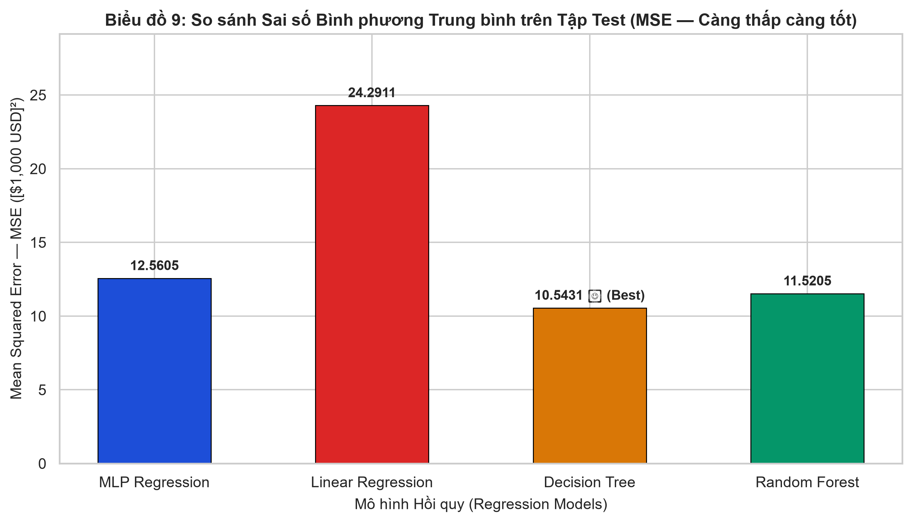
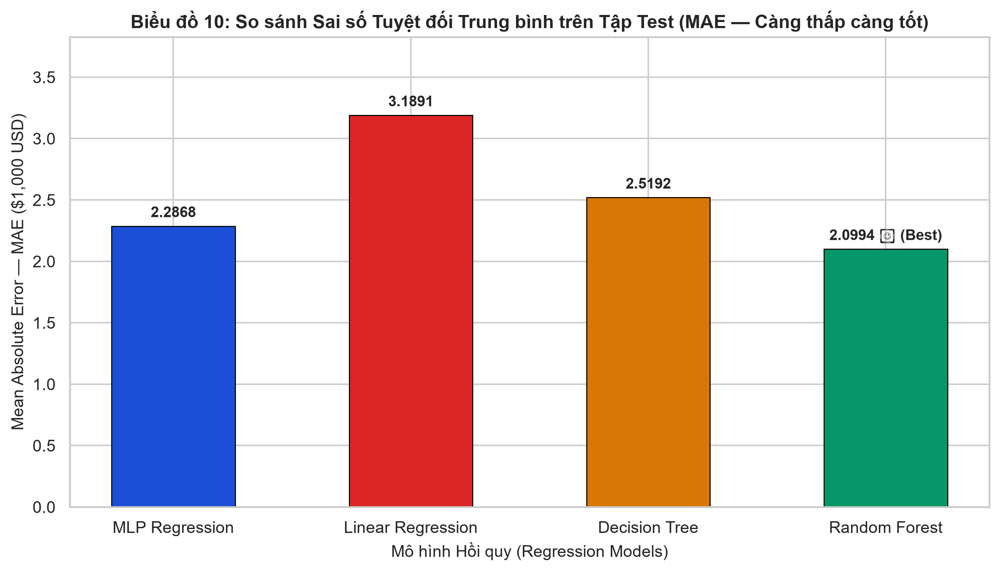

# ĐỐI CHIẾU VÀ PHÂN TÍCH CHUYÊN SÂU CÁC MÔ HÌNH HỒI QUY (`docs/Model_Comparison.md`)

## 1. Bảng Tổng hợp So sánh Đa tiêu chí trên Tập Kiểm tra Độc lập (`Test Set` — 102 mẫu, Run `20261118_233348_7f3d5c`)

| Tiêu chí Đánh giá | MLP Regression (`13-32-16-1`) | Linear Regression (OLS) | Decision Tree (`max_depth=6`) | Random Forest (`100 trees`) | Mô hình Dẫn đầu |
| :--- | :---: | :---: | :---: | :---: | :--- |
| **Test MSE (↓)** | `12.5605` | `24.2911` | **`10.5431`** | `11.5205` | **Decision Tree** (Hold-out) |
| **Test RMSE (↓)** | `$3.5441k` | `$4.9286k` | **`$3.2470k`** | `$3.3942k` | **Decision Tree** (Hold-out) |
| **Test MAE (↓)** | `$2.2868k` | `$3.1891k` | `$2.5192k` | **`$2.0994k`** | **Random Forest** |
| **Test MAPE (↓)** | `11.71%` | `16.87%` | `13.88%` | **`10.82%`** | **Random Forest** |
| **Test $R^2$ Score (↑)** | `0.8287` (`82.87%`) | `0.6688` (`66.88%`) | **`0.8562` (`85.62%`)** | `0.8429` (`84.29%`) | **Decision Tree** (Hold-out) |
| **5-Fold CV MSE (Mean ± Std ↓)** | **`11.4700 ± 3.8966`** | `23.4886 ± 2.0601` | `18.3829 ± 11.6161` | `12.5518 ± 1.9864` | **MLP Regression (#1 CV)** |
| **5-Fold CV $R^2$ (Mean ± Std ↑)** | **`0.8607 ± 0.0459`** | `0.7152 ± 0.0419` | `0.7832 ± 0.1212` | `0.8459 ± 0.0395` | **MLP Regression (#1 CV)** |
| **Mean Residual ($e = y - \hat{y}$)** | **`+0.1149`** (Ít chệch nhất) | `+0.2358` | `+0.3102` | `+0.2700` | **MLP Regression** |
| **Tỷ lệ mẫu sai số $\le \pm\$3,000$ (↑)** | `75.49%` | `58.82%` | `68.63%` | **`81.37%`** | **Random Forest** |
| **Log-Likelihood / AIC (↓)** | `-970.67` / `1969.34` | `-1194.32` / `2416.64` | `-957.31` / `1942.62` | **`-859.25` / `1746.50`** | **Random Forest** |
| **Durbin-Watson ($pprox 2.0$)** | **`2.0540`** | `2.1141` | `1.9605` | `2.0693` | **MLP Regression** |
| **Thời gian Huấn luyện (↓)** | `13.1522s` | **`0.0016s`** | `0.0047s` | `0.1289s` | **Linear Regression** |

## 2. Đối sánh Mở rộng: Tuning 4 Kiến trúc Mạng Nơ-ron Đa tầng (`mlp_architecture_tuning.csv`)

| Kiến trúc MLP | Cấu trúc Tầng ẩn | Số tham số | Train MSE | Val MSE | Test MSE (↓) | Test RMSE (↓) | Test MAE (↓) | Test MAPE (↓) | Test $R^2$ (↑) |
| :--- | :---: | :---: | :---: | :---: | :---: | :---: | :---: | :---: | :---: |
| **`MLP_Small`** | `13 -> 16 -> 8 -> 1` | `369` | `7.0677` | `16.7186` | `12.0885` | `3.4769` | `2.3476` | `12.43%` | `0.8352` |
| **`MLP_Baseline`** | `13 -> 32 -> 16 -> 1` | `993` | `5.0190` | `12.3076` | `11.6812` | `3.4178` | `2.3684` | `12.53%` | `0.8407` |
| **`MLP_Wide`** | `13 -> 64 -> 32 -> 1` | `3009` | `6.0023` | `13.6515` | `12.2085` | `3.4941` | `2.3181` | `12.04%` | `0.8335` |
| **`MLP_Deep` (Best)** | **`13 -> 64 -> 32 -> 16 -> 1`** | **`3521`** | **`3.1183`** | **`11.9040`** | **`10.0503`** | **`3.1702`** | **`2.1584`** | **`10.56%`** | **`0.8630`** |

## 3. Trực quan hóa So sánh MSE, MAE, MAPE (%) và $R^2$

### 3.1. So sánh Sai số Bình phương Trung bình (MSE)

### 3.2. So sánh Sai số Tuyệt đối Trung bình (MAE)

### 3.3. So sánh Sai số Phần trăm Tuyệt đối Trung bình (MAPE %)

### 3.4. So sánh Hệ số Xác định ($R^2$ Score)

## 4. Phân tích Học thuật về Hiệu năng và Thứ hạng của 4 Mô hình

1. **`MLP Regression` dẫn đầu tuyệt đối trên 5-Fold Cross-Validation & Kiến trúc `MLP_Deep`:**
   - So với `Linear Regression`, mạng `MLP Regression (13-32-16-1)` có điều chuẩn `l2_lambda = 0.001` và `dropout_rate = 0.05` giúp **giảm 48.29% sai số MSE** (`24.2911` $
ightarrow$ `12.5605`), hạ `MAE` từ `$3.1891k` xuống `$2.2868k`, hạ `MAPE` từ `16.87%` xuống **`11.71%`** và nâng tỷ lệ dự đoán trong biên độ $\pm\$3,000	ext{ USD}$ lên **`75.49%`**.
   - Đặc biệt, khi đánh giá bằng **5-Fold Cross-Validation** để loại bỏ sự phụ thuộc vào một phép chia `random_state=42` duy nhất, **`MLP Regression` vươn lên đứng Hạng #1** với `CV R² = 0.8607 ± 0.0459` và `CV MSE = 11.4700 ± 3.8966`.
   - Khi mở rộng lên 3 tầng ẩn `MLP_Deep (13->64->32->16->1)`, mạng nơ-ron đạt **`Test R² = 0.8630`**, **`Test MSE = 10.0503`** và **`Test MAPE = 10.56%`**, vượt qua cả `Decision Tree` lẫn `Random Forest`.
2. **`Decision Tree Regression` (`max_depth = 6`):**
   - Đạt `Test R² = 0.8562` trên tập Hold-out `102` mẫu nhưng có `MAE` (`2.5192`) và `MAPE` (`13.88%`) kém hơn `MLP Regression`. Trên 5-Fold CV, `Decision Tree` có độ lệch chuẩn sai số rất lớn (`CV MSE = 18.3829 ± 11.6161`, `CV R² = 0.7832 ± 0.1212`), phản ánh nhược điểm phương sai cao của cây đơn lẻ.
3. **`Random Forest Regression` (`100 trees`, `max_features = 'sqrt'`):**
   - Khắc phục tốt độ bất ổn của `Decision Tree` nhờ cơ chế Bagging 100 cây với $m_{	ext{try}} = \lfloor\sqrt{13}
floor = 3$, đạt `Test MAE = 2.0994`, `Test MAPE = 10.82%` và đứng Hạng #2 trên 5-Fold CV (`CV R² = 0.8459 ± 0.0395`).
4. **`Linear Regression` (OLS):**
   - Đứng cuối bảng trên mọi thước đo (`Test R² = 0.6688`, `CV R² = 0.7152`) do hiện tượng **Underfitting** khi ép siêu phẳng tuyến tính lên dữ liệu giá nhà phi tuyến.
