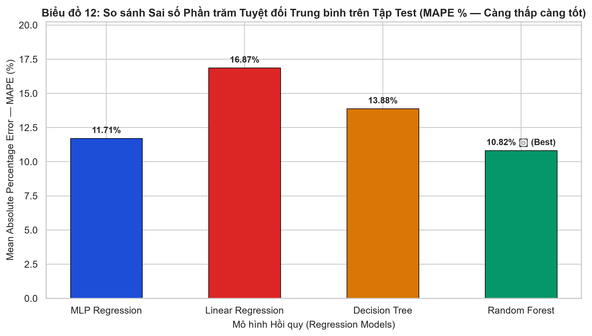
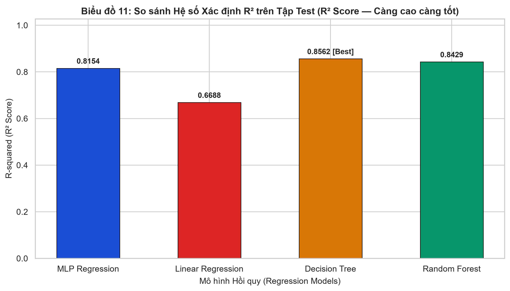

# ĐỐI CHIẾU VÀ PHÂN TÍCH CHUYÊN SÂU CÁC MÔ HÌNH HỒI QUY (MODEL_COMPARISON.MD)

## 1. Bảng Tổng hợp So sánh Đa tiêu chí trên Tập Kiểm tra (`Test Set` — 102 mẫu, Khớp 100% với `lab04.ipynb`)

| Tiêu chí Đánh giá | MLP Regression (Chapter 5) | Linear Regression | Decision Tree (`max_depth=6`) | Random Forest (`100 trees`) | Mô hình Dẫn đầu |
|---|---:|---:|---:|---:|---|
| **Test MSE (↓)** | 11.5628 | 24.2911 | **10.5431** | 11.5205 | **Decision Tree** |
| **Test RMSE (↓)** | $3.4004k | $4.9286k | **$3.2470k** | $3.3942k | **Decision Tree** |
| **Test MAE (↓)** | $2.3160k | $3.1891k | $2.5192k | **$2.0994k** | **Random Forest** |
| **Test MAPE (↓)** | 12.2206% (`12.22%`) | 16.8664% (`16.87%`) | 13.8809% (`13.88%`) | **10.8235% (`10.82%`)** | **Random Forest** |
| **Test R² Score (↑)** | 0.8423 (`84.23%`) | 0.6688 (`66.88%`) | **0.8562 (`85.62%`)** | 0.8429 (`84.29%`) | **Decision Tree** |
| **Sai số Cực đại (`Max_Error` ↓)** | $20.7288k | $25.2604k | **$10.6500k** | $22.6003k | **Decision Tree** |
| **Mean Residual ($e = y - \hat{y}$)** | **0.0533** (Ít chệch nhất) | 0.2358 | 0.3102 | 0.2700 | **MLP Regression** |
| **Tỷ lệ mẫu sai số $\le \pm\$3,000$ (↑)** | 72.55% | 58.82% | 68.63% | **81.37%** | **Random Forest** |
| **Thời gian Huấn luyện (↓)** | 15.7892s | 0.0083s | **0.0071s** | 0.1577s | **Decision Tree** |
| **Thời gian Dự đoán 102 mẫu (↓)** | 0.104323s | **0.000465s** | 0.000574s | 0.013978s | **Linear Regression** |

## 2. Trực quan hóa So sánh MSE, MAE, MAPE (%) và R²

### 2.1. So sánh Sai số Bình phương Trung bình (MSE)

### 2.2. So sánh Sai số Tuyệt đối Trung bình (MAE)

### 2.3. So sánh Sai số Phần trăm Tuyệt đối Trung bình (MAPE %)

### 2.4. So sánh Hệ số Xác định ($R^2$ Score)

## 3. Phân tích Học thuật về Hiệu năng và Thứ hạng của 4 Mô hình (Theo Cells 17 & 20 `lab04.ipynb`)

### 3.1. Multilayer Perceptron (MLP) Regression (`keras.Sequential` — 993 tham số)
- **Bước nhảy vọt so với mô hình tuyến tính**:
  - Mạng `MLP Regression` (`Input(13) -> Dense(32, ReLU) -> Dense(16, ReLU) -> Dense(1, Linear)`) **giảm 52.40% sai số MSE** (từ `24.2911` xuống `11.5628`), **giảm 27.38% sai số tuyệt đối MAE** (từ `$3.1891k` xuống `$2.3160k`), hạ **MAPE** từ `16.87%` xuống **`12.22%`** và nâng hệ số xác định **$R^2$** từ `0.6688` lên **`0.8423`** so với `Linear Regression`.
- **Đối sánh trực tiếp với các mô hình cây (`Decision Tree` và `Random Forest`)**:
  - Về phương sai giải thích ($R^2$), `MLP Regression` (`0.8423`) bám cực sát `Random Forest` (`0.8429`) và `Decision Tree` (`0.8562`).
  - Đáng chú ý, trên các chỉ số sai số tuyệt đối và sai số phần trăm, **`MLP Regression` vượt qua `Decision Tree`**: `MAE` đạt `2.3160` (so với `2.5192` của Decision Tree), `MAPE` đạt `12.22%` (tốt hơn mức `13.88%` của Decision Tree) và tỷ lệ dự đoán sai lệch trong khoảng $\pm \$3,000	ext{ USD}$ đạt **`72.55%`** (cao hơn `68.63%` của Decision Tree).

### 3.2. Decision Tree Regression (`max_depth = 6`)
- Đạt **MSE thấp nhất (`10.5431`)** và **$R^2$ cao nhất (`0.8562`)** trên tập Test nhờ hai đặc trưng chủ lực `RM` (`Feature_Importance = 0.6278`) và `LSTAT` (`0.1957`) phân hoạch tốt các nhóm nhà giá cao, giúp kiểm soát sai số cực đại (`Max_Error = 10.6500`). Tuy nhiên, do dự đoán bằng hằng số từng khúc tại các nút lá, sai số phần trăm trung bình (`MAPE = 13.88%`) và `MAE` (`2.5192`) của cây đơn lẻ vẫn cao hơn `MLP Regression` và `Random Forest`.

### 3.3. Random Forest Regression (`n_estimators = 100, max_depth = 10`)
- Đạt **MAE thấp nhất (`2.0994`)**, **MAPE thấp nhất (`10.82%`)** và tỷ lệ dự đoán trong biên độ $\pm \$3,000	ext{ USD}$ cao nhất (**`81.37%`**) nhờ cơ chế Bagging lấy trung bình cộng 100 cây quyết định, giúp làm mịn bề mặt dự đoán trên dữ liệu dạng bảng.

### 3.4. Linear Regression
- Xếp cuối cùng trên toàn bộ 5 chỉ số (`MSE = 24.2911`, `RMSE = 4.9286`, `MAE = 3.1891`, `MAPE = 16.87%`, `R² = 0.6688`) do bị **Underfitting** khi ép một siêu phẳng tuyến tính lên mối quan hệ cong phi tuyến của thị trường nhà ở Boston.
